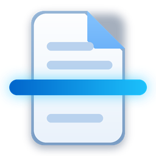
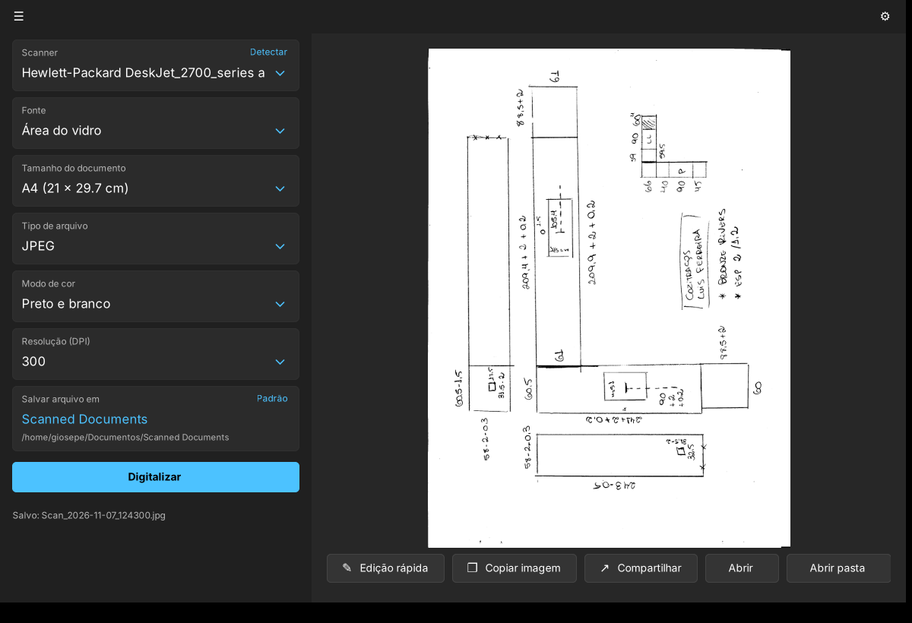
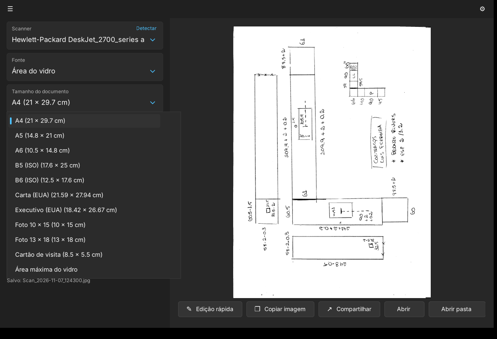
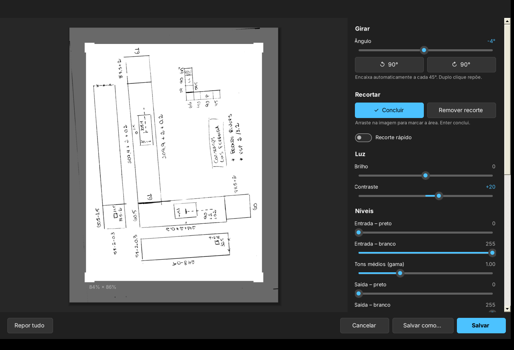
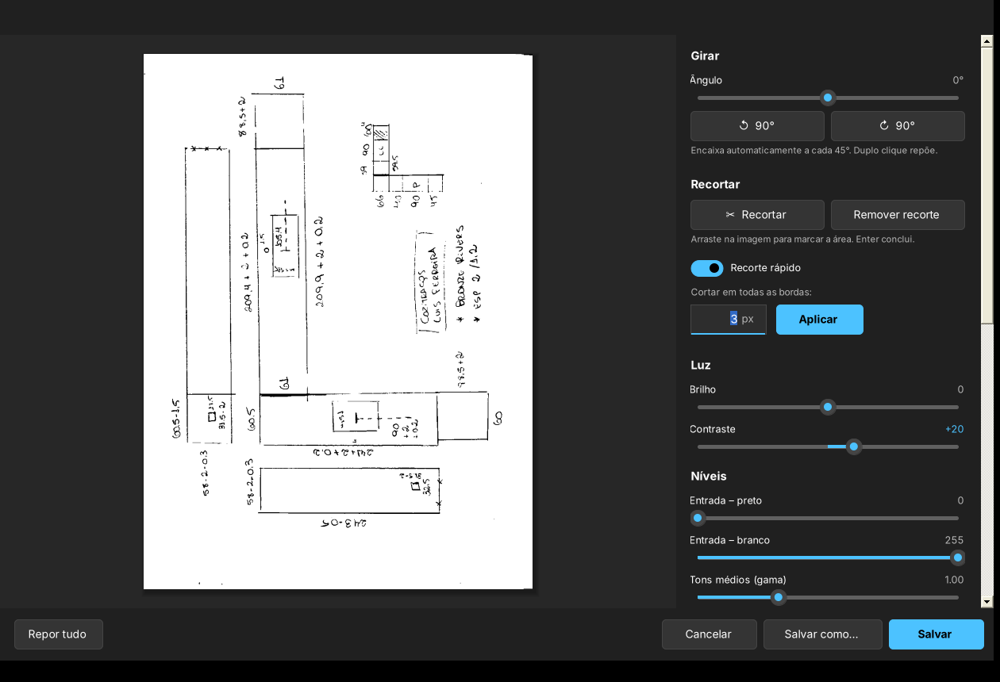
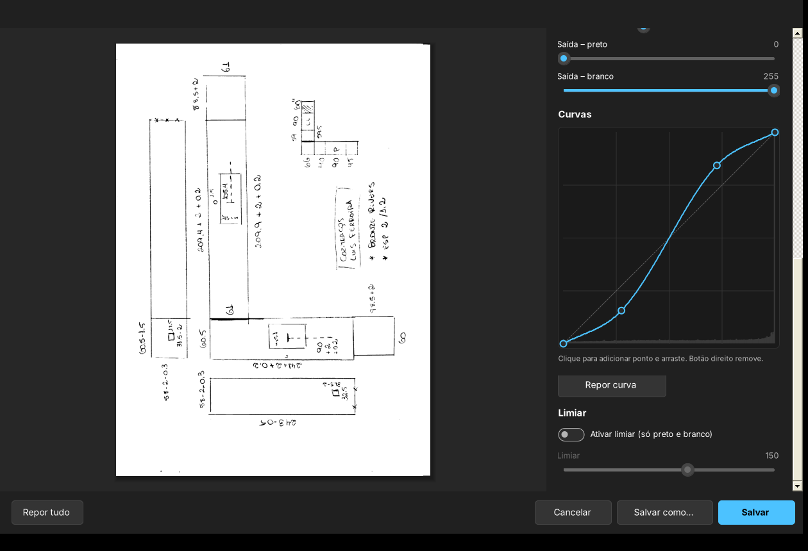
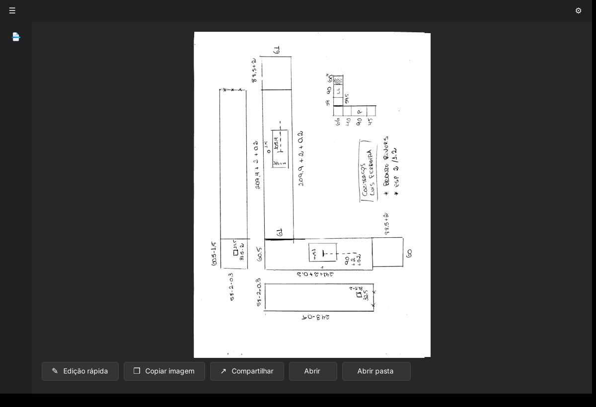
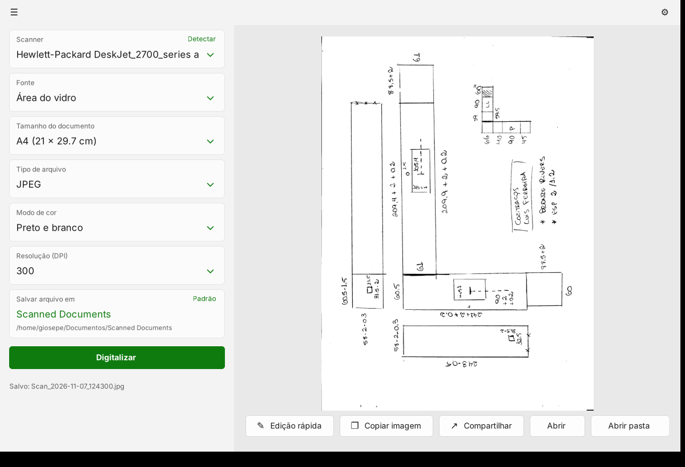
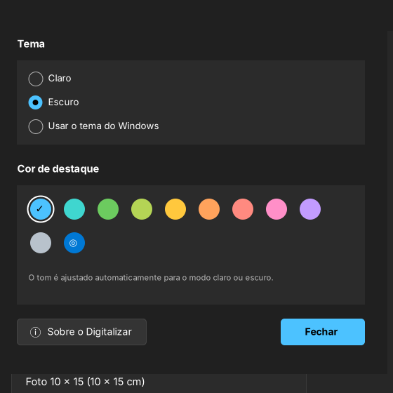
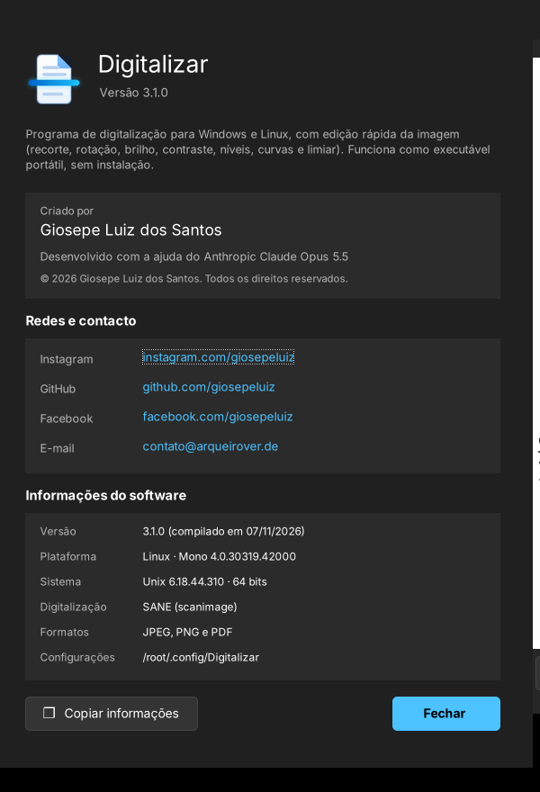

<div align="center">



# Project Scanner · Digitalizar

### Digitalize, ajuste e compartilhe em segundos, sem instalar nada.

[](https://github.com/giosepeluiz/project-scanner/releases/latest)
[](https://github.com/giosepeluiz/project-scanner/releases/latest)
[](https://github.com/giosepeluiz/project-scanner/releases/latest)
[](LICENSE)

**[⬇️ Baixar](#️-download)** · **[📖 Como usar](#-como-funciona-passo-a-passo)** · **[🕰️ Versões](#️-histórico-de-versões)** · **[🤝 Contribuir](#-código-aberto-contribua)**



</div>

> 🇬🇧 **English summary:** *Digitalizar* is a free, portable scanning app for Windows (WIA) and Linux (SANE). Scan to JPEG, PNG or PDF, copy the image right after scanning, and crop, rotate or fix it in a built-in quick editor. No installation needed. Open source under the MIT license.

---

## 👋 Olá!

Existem vários programas de digitalização por aí, e eu sei disso. O **Digitalizar** nasceu de uma necessidade pessoal: eu precisava de alguns recursos que os outros programas não tinham, e não precisava de outros tantos que deixavam esses programas pesados, lentos e cheios de telas.

Então ele é, de propósito, **um aplicativo simples, com o básico bem feito**: você abre, escolhe as opções, digitaliza e pronto. O arquivo é salvo automaticamente e você já pode **copiar a imagem** para colar onde quiser (WhatsApp, e-mail, Affinity, Word…) logo depois de digitalizar, sem precisar abrir o arquivo.

Com o tempo ele ganhou um editor rápido para corrigir a imagem, visual moderno no estilo do Windows 11, tema claro e escuro, cores de destaque e até uma versão para Linux. E continua leve: cabe num pendrive e não instala nada no seu computador.

## ✨ O que ele faz

| | |
|---|---|
| 🖨️ **Encontra o scanner sozinho** | Detecta impressoras multifuncionais e scanners ligados por USB ou Wi-Fi |
| 📄 **Tamanhos de papel padrão** | A4, A5, A6, B5, B6, Carta, Executivo, fotos 10 × 15 e 13 × 18, cartão de visita ou área máxima do vidro |
| 🎨 **Cor, cinza ou preto e branco** | De 75 a 1200 DPI |
| 💾 **JPEG, PNG ou PDF** | Salvo automaticamente na pasta que você escolher |
| 📋 **Copiar logo depois de digitalizar** | É só colar com Ctrl+V onde quiser |
| ✂️ **Edição rápida** | Recortar, girar, brilho, contraste, níveis, curvas e limiar, com pré-visualização ao vivo |
| ↗️ **Compartilhar** | Abre a janela de compartilhamento do Windows |
| 🌗 **Tema claro, escuro ou do sistema** | Mais 10 cores de destaque (ou a cor do próprio Windows) |
| 🎒 **Portátil** | Um único arquivo, sem instalação |

## ⬇️ Download

Pegue a versão mais recente em **[Releases](https://github.com/giosepeluiz/project-scanner/releases/latest)**:

| Sistema | Arquivo | Como usar |
|---|---|---|
| 🪟 **Windows 10/11** | [`Digitalizar-3.1.0-windows.zip`](https://github.com/giosepeluiz/project-scanner/releases/download/v3.1.0/Digitalizar-3.1.0-windows.zip) | Descompacte e abra o `Digitalizar.exe`. Pronto! |
| 🐧 **Linux** | [`Digitalizar-3.1.0-linux.tar.gz`](https://github.com/giosepeluiz/project-scanner/releases/download/v3.1.0/Digitalizar-3.1.0-linux.tar.gz) | Descompacte e rode `./digitalizar.sh` (veja abaixo) |

> [!WARNING]
> **Na primeira vez, o Windows pode mostrar um aviso azul ("O Windows protegeu o computador").** Isso acontece com todo programa sem assinatura digital paga. Clique em **Mais informações → Executar assim mesmo**. O código está todo aqui, aberto, para quem quiser conferir.

### 🐧 No Linux

Você precisa do **Mono** (para rodar o programa) e do **SANE** (para falar com o scanner):

```bash
sudo apt install mono-complete sane-utils    # Debian / Ubuntu / Mint
sudo apt install hplip                       # se o scanner for HP (ex.: DeskJet 2700)

tar -xzf Digitalizar-3.1.0-linux.tar.gz
cd Digitalizar
./digitalizar.sh                             # abre o programa
./instalar-atalho.sh                         # (opcional) cria o atalho no menu
```

> As versões **1.0 e 2.x são só para Windows**. A versão para **Linux** existe a partir da **3.1**.

## 📖 Como funciona, passo a passo

### 1. Digitalizar



1. Coloque o documento no vidro, encostado no **canto de referência** (normalmente marcado com uma setinha).
2. Escolha o **Scanner**. Se a impressora estava desligada, ligue-a e clique em **Detectar**.
3. Escolha o **Tamanho do documento**. O programa digitaliza só aquela área, o que é mais rápido e gera arquivos menores.
4. Escolha o **Tipo de arquivo**, o **Modo de cor** e a **Resolução**. Uma dica: 300 DPI é ótimo para documentos e 600 para desenhos com detalhes finos.
5. Clique em **Digitalizar**. A imagem aparece à direita e é **salva automaticamente** com um nome tipo `Scan_2026-11-07_124300.jpg`.

Para trocar a pasta de destino, clique no card **Salvar arquivo em**; o link **Padrão** volta para a pasta original.

### 2. Depois de digitalizar

| Botão | O que faz |
|---|---|
| ✎ **Edição rápida** | Abre o editor (ou dê duplo clique na pré-visualização) |
| ❐ **Copiar imagem** | Copia para a área de transferência: é só colar com Ctrl+V |
| ↗ **Compartilhar** | Abre a janela de compartilhamento do Windows (e-mail, Teams, Bluetooth, apps…) |
| **Abrir** | Abre o arquivo no visualizador padrão |
| **Abrir pasta** | Abre a pasta com o arquivo já selecionado |

### 3. Edição rápida



- **Girar:** slider de −180° a +180° que **encaixa sozinho a cada 45°**, mais botões para girar 90° para cada lado.
- **Recortar:** clique em *Recortar*, arraste na imagem para marcar a área, mova o retângulo ou ajuste pelos cantos, e conclua com **Enter**.



- **Recorte rápido:** ligue o switch, escolha quantos pixels cortar (o padrão é **3 px**) e clique em **Aplicar**. Ele corta a mesma medida em todas as bordas, ótimo para tirar aquela sombra preta que o scanner deixa na borda. Cada clique corta mais um pouco.
- **Brilho e contraste.**



- **Níveis:** ponto preto e branco de entrada, tons médios (gama) e ponto preto e branco de saída.
- **Curvas:** clique na curva para criar pontos e arraste; o botão direito remove um ponto. O histograma da imagem aparece ao fundo para ajudar.
- **Limiar:** transforma a imagem em preto e branco puro, perfeito para desenhos feitos à mão.
- **Salvar** substitui o arquivo; **Salvar como…** grava com outro nome ou noutro formato (JPEG, PNG ou PDF).

> 💡 A pré-visualização é rápida, mas ao salvar as edições são aplicadas na **resolução original**, sem perder qualidade. Dê duplo clique num slider para voltar ao valor padrão.

### 4. Personalizar

<p>


</p>

- **☰** recolhe e expande o painel lateral, com uma animação suave. Recolhido, sobra mais espaço para a imagem e fica só o botão de digitalizar.
- **⚙ Opções:** tema **claro**, **escuro** ou **do Windows**, e a **cor de destaque**. A mudança aparece na hora e fica guardada.

<p>


</p>

- **Sobre (F1):** autoria, contato e informações técnicas, com um botão para copiá-las.

### ⌨️ Atalhos

| Tecla | Ação |
|---|---|
| `F1` | Abre a janela Sobre |
| `Ctrl + S` | Salvar (no editor) |
| `Ctrl + Shift + S` | Salvar como (no editor) |
| `Enter` | Concluir o recorte |
| `Esc` | Sair do recorte / fechar a janela |
| Duplo clique num slider | Voltar ao valor padrão |

Quer mais detalhes? Veja o **[Manual completo](docs/MANUAL.md)**.

## 🕰️ Histórico de versões

### 🚀 Versão 3.x: "Cara nova" + "Muito prazer!"
**Release: [v3.1.0](https://github.com/giosepeluiz/project-scanner/releases/tag/v3.1.0)** · 🪟 Windows + 🐧 Linux

A maior atualização até agora. O programa passou a parecer (e se comportar como) um app nativo do Windows 11, e ainda ganhou uma versão para Linux.

**O que chegou na 3.0:**
- **Barra de título integrada**, como no Chrome: o menu, o nome do programa e as opções ficam dentro da própria barra. E continua tudo funcionando: arrastar, duplo clique para maximizar, encaixar nas bordas e os *layouts* de encaixe do Windows 11 ao passar o mouse no botão maximizar.
- **Painel lateral recolhível** com uma animação suave.
- **Tamanho do documento:** 11 tamanhos padrão (ISO 216 e norte-americanos), com medidas em cm. O programa só digitaliza aquela área.
- **Opções:** tema claro, escuro ou do sistema, e 10 cores de destaque (ou a do Windows). Cada cor tem um tom pensado para o modo claro e outro para o escuro.
- **Compartilhar:** a janela de partilha do Windows, direto do programa.
- **Ícone novo e minimalista**, redesenhado para cada tamanho (16 a 256 px), para ficar nítido em qualquer lugar.
- Botões com os ícones do Windows 11; quando a janela fica estreita, eles viram só ícone.

**O que a 3.1 acrescentou:**
- Janela **Sobre**: quem criou, redes sociais, contato e todas as informações técnicas, com um botão para copiá-las (útil se precisar relatar um problema).
- Atalho **F1** para abrir o Sobre.
- O nome do autor aparece nas propriedades do `.exe` (botão direito → Propriedades → Detalhes).
- 🐧 **Estreia no Linux!** O mesmo programa roda com o Mono e usa o SANE para falar com o scanner. As diferenças: usa a barra de título do próprio Linux, e o "Compartilhar" abre a pasta do arquivo.

### 🖌️ Versão 2.x: "Agora dá para editar" + "Ajustes finos"
**Release: [v2.1.0](https://github.com/giosepeluiz/project-scanner/releases/tag/v2.1.0)** · 🪟 Windows

**O que chegou na 2.0:**
- A **Edição rápida**: recortar, girar (encaixando a cada 45°), brilho, contraste, níveis, curvas e limiar, com **Salvar** e **Salvar como**.
- Seletores com cara de Windows 11: cards integrados ao app, com seta azul e menu escuro.
- Botões arredondados, barra de progresso fina e pré-visualização maior.
- O primeiro ícone próprio do programa.

**O que a 2.1 acrescentou:**
- **Recorte rápido:** um switch que, ligado, corta X pixels de todas as bordas com um clique (3 px por padrão).
- O texto do menu dos seletores estava descentrado na vertical; foi corrigido.
- Painéis laterais um pouco mais largos, para respirar melhor.
- O limiar ganhou um switch no estilo Windows 11.
- O ícone foi redesenhado no estilo Fluent.

### 🌱 Versão 1.0: "O começo de tudo"
**Release: [v1.0.0](https://github.com/giosepeluiz/project-scanner/releases/tag/v1.0.0)** · 🪟 Windows

A primeira versão: um executável de apenas **34 KB** que funciona sem instalar nada.
- Reconhece o scanner pelo **WIA**, o mesmo sistema do app "Digitalizar" do Windows.
- Fonte: área do vidro. Tipos: JPEG, PNG e PDF. Modos: cor, cinza e preto e branco. Resoluções de 75 a 1200 DPI.
- Salva na pasta *Documentos › Scanned Documents*, com opção de escolher outra.
- Depois de digitalizar: **Copiar imagem**, **Abrir** e **Abrir pasta**.

📜 O histórico completo, com todos os detalhes técnicos, está no **[CHANGELOG](CHANGELOG.md)**.

## 🛠️ Para desenvolvedores

O projeto é escrito em **C#** (Windows Forms) e é compatível com o compilador que **já vem no Windows**: não precisa instalar o Visual Studio nem o .NET SDK.

```bat
cd src
compilar.bat
```

No Linux, compile com o Mono:

```bash
cd src
mcs -target:winexe -out:Digitalizar.exe -win32icon:Digitalizar.ico \
    -resource:Digitalizar.ico,Digitalizar.ico \
    $(for t in 16 20 24 32 40 48 64; do echo -n "-resource:icones/Digitalizar_$t.png,ico_$t.png "; done) \
    -r:System.Windows.Forms.dll -r:System.Drawing.dll -r:Microsoft.CSharp.dll -r:System.Core.dll -r:System.dll *.cs
```

| Arquivo | O que tem |
|---|---|
| `src/Janela.cs` | Janela principal e inicialização |
| `src/Editor.cs` | Edição rápida (recorte, rotação, tons) |
| `src/Comum.cs` | Scanner (WIA no Windows, SANE no Linux), processamento de imagem e gerador de PDF |
| `src/Controles.cs` | Controles próprios: seletores, botões, sliders, switch, editor de curvas |
| `src/Moldura.cs` | Barra de título integrada |
| `src/Tema.cs` | Temas, cores de destaque e configurações |
| `src/Opcoes.cs` · `src/Sobre.cs` | Janelas de Opções e Sobre |

Cada versão está marcada com uma *tag* (`v1.0.0`, `v2.1.0`, `v3.1.0`), então dá para ver o código de qualquer uma delas.

## 🤝 Código aberto: contribua!

Este projeto é de **código aberto**, sob a **[licença MIT](LICENSE)**. Você pode usar, estudar, modificar e distribuir à vontade, inclusive em projetos comerciais, desde que mantenha o aviso de direitos autorais.

Encontrou um bug? Tem uma ideia? Quer melhorar algo? **Toda contribuição é bem-vinda!**

1. Faça um **fork** do projeto.
2. Crie uma branch para a sua alteração: `git checkout -b minha-melhoria`
3. Faça o commit: `git commit -m "Adiciona tal coisa"`
4. Envie para o seu fork: `git push origin minha-melhoria`
5. Abra um **Pull Request** contando o que mudou.

Prefere só avisar? Abra uma **[Issue](https://github.com/giosepeluiz/project-scanner/issues)**. Mais detalhes em **[CONTRIBUTING](CONTRIBUTING.md)**.

## 👤 Autor

<table>
<tr>
<td>

Criado por **Giosepe Luiz dos Santos**, com a ajuda do **Anthropic Claude Opus 5.5**.

[](https://instagram.com/giosepeluiz)
[](https://github.com/giosepeluiz)
[](https://facebook.com/giosepeluiz)
[](mailto:contato@arqueirover.de)

</td>
</tr>
</table>

## 💬 Para terminar

Se o Digitalizar te poupou alguns minutos (ou alguma dor de cabeça com programas pesados), deixe uma ⭐ no repositório: isso ajuda outras pessoas a encontrá-lo. E se fizer algo legal com o código, me conta!

<div align="center">

*Feito com ☕ entre o Brasil e Portugal.*

</div>
