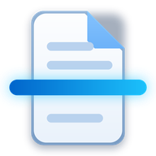

<div align="center">



# Digitalizar para Android 📱

### O mesmo Digitalizar do Windows e do Linux, agora no celular, e com câmera inteligente.


</div>

> 🇬🇧 **English summary:** the Android version of *Digitalizar*. It finds Wi-Fi scanners on your network (eSCL / AirScan, e.g. HP DeskJet 2700) **and** can scan with the phone camera: a built-in document detector finds the page, fixes the perspective and turns the photo into a clean scan. Same quick editor, 15 languages and remembered settings as the desktop app. ~350 KB, no Google services required.

---

## 👋 O que mudou em relação ao computador?

O Android segue a numeração do Digitalizar de PC com uma diferença de duas "casas": a **1.2** do Android acompanha as funções da **3.2** do PC (idiomas, temas, edição rápida). São dois apps separados, no mesmo repositório.

| | 🖥️ PC (Windows / Linux) | 📱 Android |
|---|---|---|
| **Versão** | 3.2.0 | **1.2.0** |
| **Linguagem** | C# (Windows Forms) | Java puro, sem AndroidX e sem Gradle |
| **Origem da digitalização** | Scanner USB ou de rede (WIA no Windows, SANE no Linux) | **Scanner de rede** (eSCL / AirScan / Mopria) **ou câmera do celular** |
| **Câmera inteligente** | Não tem | **Sim**: detecta a folha, endireita, tira sombras e vira um scan |
| **Galeria** | Não tem | Abre fotos da galeria pelo mesmo processo da câmera |
| **Scanner USB** | Sim | Não (o celular só fala com scanners na rede Wi-Fi) |
| **Adicionar scanner** | Detecção automática | Detecção automática (mDNS) ou **Adicionar por IP** |
| **Salvar** | Salva automaticamente depois de digitalizar | **Só salva quando você toca em "Salvar"** |
| **PDF** | Um PDF por digitalização | **PDF com várias páginas**: adicionar e excluir páginas antes de salvar |
| **Cor depois de digitalizar** | Definida antes de digitalizar | **Pode trocar depois**: colorido vira cinza ou P&B e volta (uma digitalização feita em cinza ou P&B não volta a ser colorida) |
| **Pasta de destino** | Documentos › Scanned Documents, ou a que você escolher | Documentos › Scanned Documents ou pasta escolhida (acesso do Android) |
| **Copiar / compartilhar** | Copiar imagem (Ctrl+V) e compartilhar do Windows | Copiar, compartilhar e abrir pelo próprio Android |
| **Edição rápida** | Recorte, giro, brilho, contraste, níveis, curvas e limiar | Os mesmos recursos, adaptados ao toque |
| **Tamanhos, modos e DPI** | A4 a área máxima, cor/cinza/P&B, 75 a 1200 DPI | Iguais |
| **Idiomas e temas** | 15 idiomas, claro/escuro/sistema, 10 cores de destaque | Iguais (mesmo `idiomas.tsv` de base) |
| **Ícones** | Próprios do projeto | Font Awesome Free (sem emojis na interface) |
| **Instalação** | Portátil, um arquivo | APK de cerca de 350 KB, sem serviços do Google |
| **Requisitos** | Windows 10/11 ou Linux com Mono e SANE | Android 10 ou mais novo |

A novidade é a **origem**. No topo da tela você escolhe:

| | |
|---|---|
| 🖨️ **Scanner da rede** | O celular procura sozinho as impressoras multifuncionais na mesma rede Wi-Fi (protocolo eSCL / AirScan / Mopria, o mesmo da HP DeskJet 2700). Se ela não aparecer, dá para adicionar pelo endereço IP. |
| 📷 **Câmera** | Aponte para a folha: o app desenha o contorno do documento ao vivo e tira a foto sozinho quando você para de mexer. Depois endireita a folha e transforma a foto num scan. |

## 🧠 A "inteligência" da câmera

Ela foi escrita do zero, em Java puro, sem OpenCV e sem os serviços do Google, para funcionar em qualquer Android e ficar leve. Em cada quadro da câmera ela:

1. **Procura a folha** de três jeitos ao mesmo tempo: pelas bordas que formam uma "cerca" fechada, pela folha clara sobre fundo escuro e pelo contrário. Cada candidato ganha uma nota (parece um retângulo? tem bordas fortes nos lados? os ângulos fazem sentido?) e o melhor vence. Se o bloco de texto parece um retângulo dentro de outro maior, ela sabe que a folha é o de fora.
2. **Acerta os cantos** na foto em alta resolução: procura a borda verdadeira ao longo de cada lado, traça uma reta e cruza as retas vizinhas. O erro cai de uns 30 px para cerca de 2 px.
3. **Endireita a perspectiva** e, se a proporção estiver perto do papel escolhido (A4, Carta…), usa a proporção exata.
4. **Transforma em scan**: estima a luz em cada zona da folha e divide por ela. Isso tira sombras e o tom amarelado da lâmpada, deixa o fundo branco e a tinta nítida. Em *Preto e branco* vira um P&B limpo; em *Cor* as cores ficam mais vivas.

Na tela de revisão você pode arrastar os cantos (com lupa para acertar) e escolher entre **Realce automático** e **Original**.

> 💡 Dá também para abrir uma foto da **Galeria**: ela passa pelo mesmo processo.

## ⬇️ Instalar

1. Baixe o `Digitalizar-1.2.0-android.apk` no celular.
2. Toque nele. Na primeira vez o Android pede para **permitir a instalação de apps desta fonte**: permita e volte.
3. Pronto! Na primeira vez que usar a câmera, ele pede a permissão.

Precisa do **Android 10 ou mais novo**.

## 📖 Como usar

1. Escolha a **Origem**: *Scanner da rede* ou *Câmera*.
2. Escolha o **Tamanho do documento**, o **Tipo de arquivo** (JPEG, PNG ou PDF), o **Modo de cor** e a **Resolução**.
3. Toque em **Digitalizar**. A imagem aparece na tela, mas **ainda não é salva**: você decide.
4. Quer outra cor? Mude o **Modo de cor** depois de digitalizar: o que foi digitalizado em *Cor* pode virar *Cinza* ou *Preto e branco* (e voltar). O tipo de arquivo também pode mudar até salvar.
5. Toque em **Salvar**. O arquivo vai para **Documentos › Scanned Documents** (ou a pasta que você escolher no card *Salvar arquivo em*), com um nome tipo `Scan_2026-11-07_124300.jpg`. Se mudar algo depois, é só tocar em **Salvar** de novo.
6. Use os botões de baixo: **Edição rápida**, **Copiar imagem** (é só colar no WhatsApp, e-mail…), **Compartilhar**, **Abrir** e **Abrir pasta**. Copiar e compartilhar funcionam mesmo antes de salvar.

> 🖨️ **O scanner não aparece?** O celular e a impressora precisam estar na **mesma rede Wi-Fi**. Toque em **Detectar** de novo ou em **Adicionar por IP** (o IP aparece no relatório de rede da impressora ou no app dela).

### 📄 Várias páginas no mesmo PDF

Com o tipo **PDF**, depois da primeira digitalização aparece o card **Páginas** com as miniaturas:

- **Adicionar página** digitaliza mais uma folha (pelo scanner ou pela câmera) e coloca no fim do mesmo PDF.
- Toque numa miniatura para **ver ou editar** aquela página na Edição rápida.
- A **lixeira** no canto da miniatura **exclui a página** (pede confirmação).

Nada é gravado até você tocar em **Salvar**. No PDF, as páginas em preto e branco ficam em 1 bit (arquivo bem pequeno). Se escolher JPEG ou PNG com várias páginas, cada página vira um arquivo (`…_p1.jpg`, `…_p2.jpg`).

### ✂️ Edição rápida

Igual à do computador, adaptada ao toque: girar (encaixa a cada 45°, mais botões de 90°), recortar arrastando na imagem, recorte rápido de X pixels em todas as bordas, brilho, contraste, níveis, curvas (toque para criar um ponto, toque longo para apagar, com o histograma ao fundo) e limiar. **Toque duplo** num slider volta ao valor padrão. Ao tocar em **Aplicar**, tudo é feito na resolução original da página; depois é só **Salvar** na tela principal.

### ⚙️ Opções

Idioma (os mesmos 15, abre no idioma do sistema), tema claro, escuro ou do sistema e as 10 cores de destaque, mais a **cor do sistema** (Material You, no Android 12+). **Tudo fica guardado**: origem, scanner, tamanho, tipo, cor, resolução, pasta, painel recolhido, captura automática, lanterna, filtro e o valor do recorte rápido.

## 🛠️ Para desenvolvedores

O app é escrito em **Java** usando só a API do Android (sem AndroidX, sem Gradle): o APK tem cerca de **160 KB**. As traduções usam o mesmo `idiomas.tsv` da versão para computador (em `app/assets/`), com as frases novas no fim.

```bash
tools/preparar.sh      # baixa aapt2, dx, android.jar e apksigner para /opt/asdk (uma vez só)
./build.sh             # gera build/Digitalizar-1.2.0-android.apk
teste/testar.sh        # testa a deteção do documento no computador, com fotos sintéticas
```

O `build.sh` assina com `keystore/digitalizar.jks` (senha na variável `KS_PASS`). **Guarde essa chave**: o Android só aceita atualizar o app se a nova versão for assinada com a mesma chave. Ela não deve ir para o GitHub (já está no `.gitignore`).

| Arquivo | O que tem |
|---|---|
| `Principal.java` | Tela principal, gravação e ações (copiar, compartilhar, abrir) |
| `Escl.java` | Scanner da rede: deteção por mDNS e digitalização eSCL |
| `Camera.java` | Câmera ao vivo (Camera2), contorno, captura automática, lanterna, galeria |
| `Revisao.java` | Ajuste dos cantos com lupa, filtro e "transformar em scan" |
| `Visao.java` | A inteligência: deteção, refino dos cantos, perspectiva e realce |
| `Editor.java` | Edição rápida |
| `Imagens.java` | Processamento, JPEG/PNG/PDF e pastas de destino |
| `Ui.java` · `Tema.java` · `L.java` | Controles, temas/cores e idiomas |
| `Opcoes.java` · `Sobre.java` · `Provedor.java` | Opções, Sobre e a partilha de arquivos com outros apps |

## 🎨 Ícones

Os ícones do app são do [Font Awesome Free 6.7.2](https://fontawesome.com) (ícones CC BY 4.0, fonte SIL OFL 1.1). A fonte vai sem modificação em `app/assets/fontawesome/`, junto com a licença.

## ❤️ Criado por

**Giosepe Luiz dos Santos**, com a ajuda do Anthropic Claude Opus 5.5. Código aberto sob a licença MIT, como o resto do projeto.
