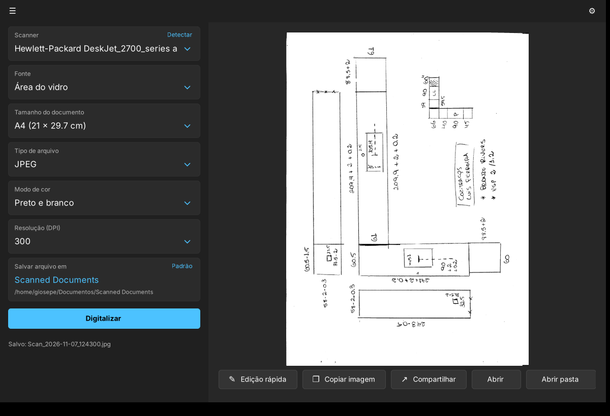
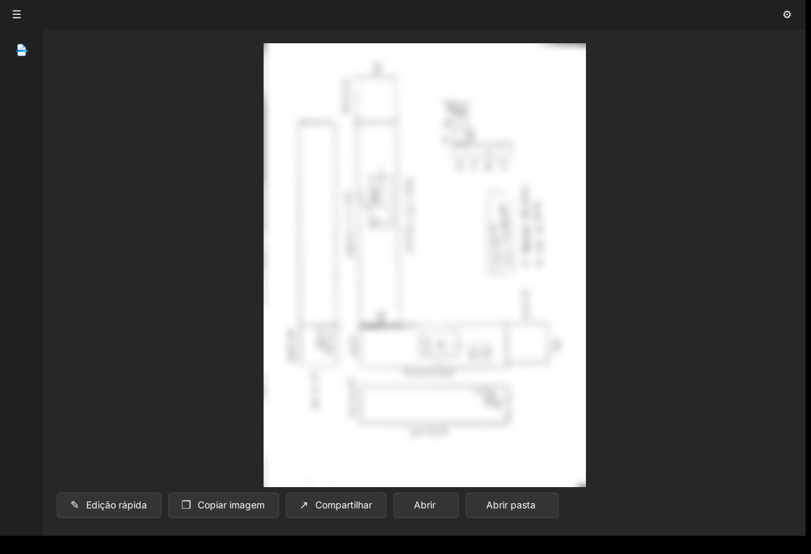
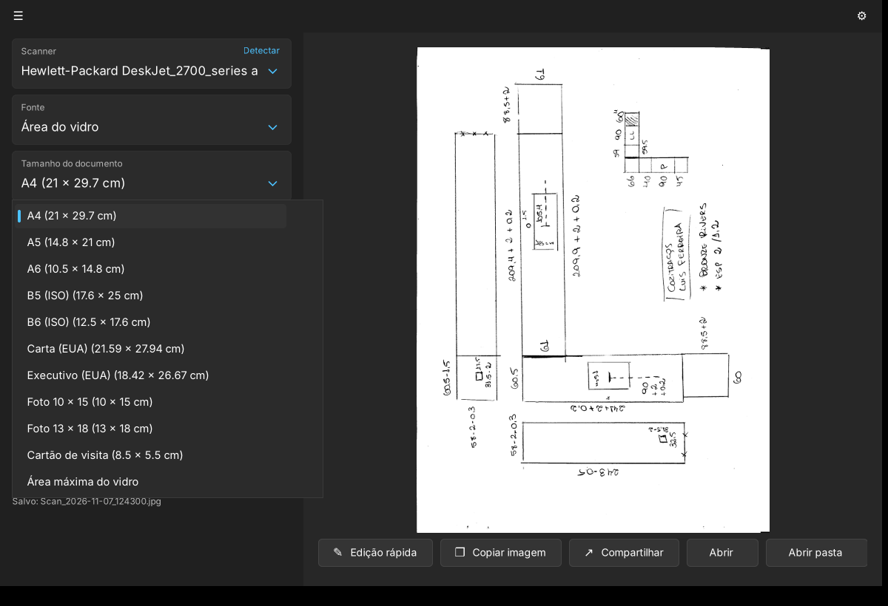
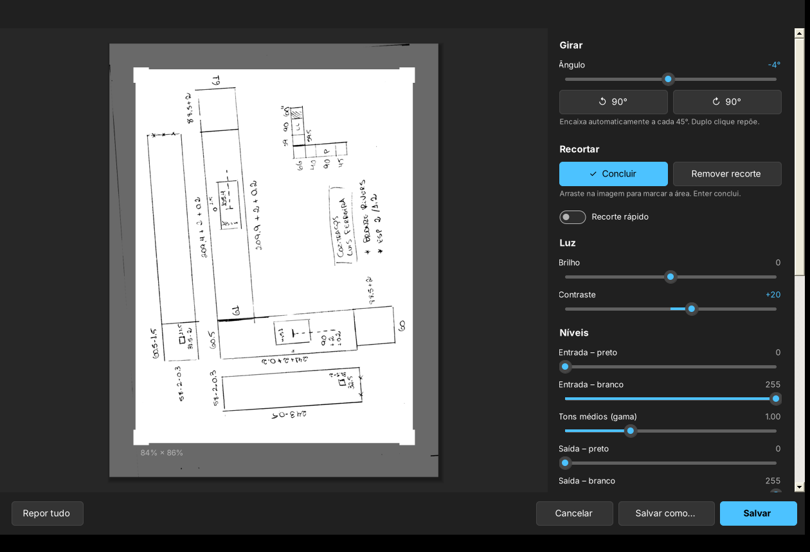
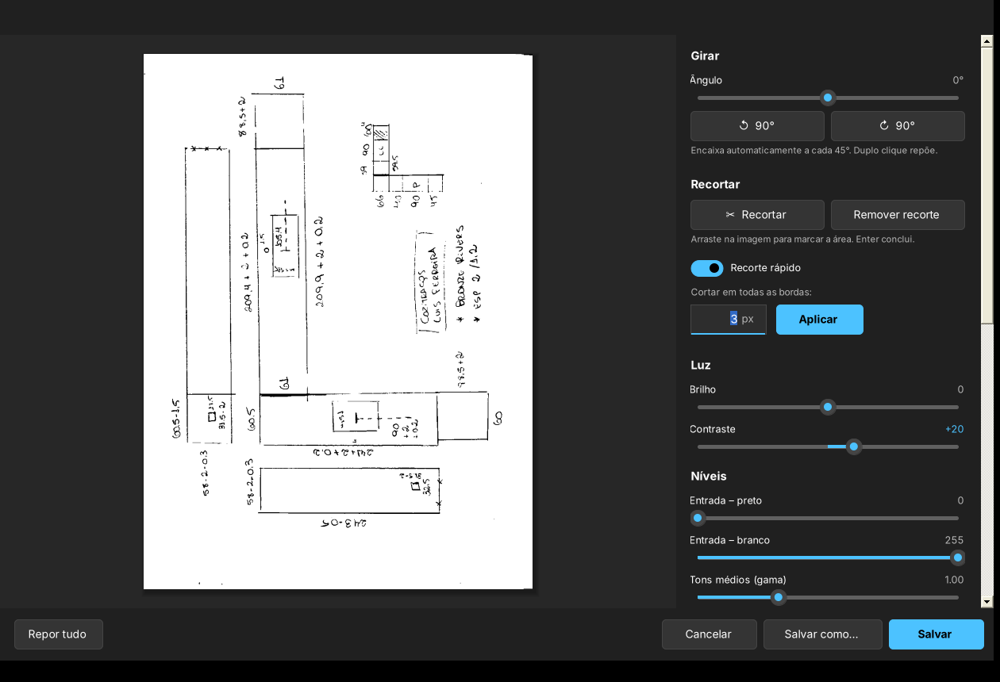
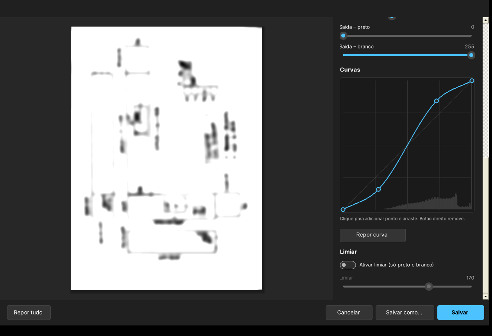
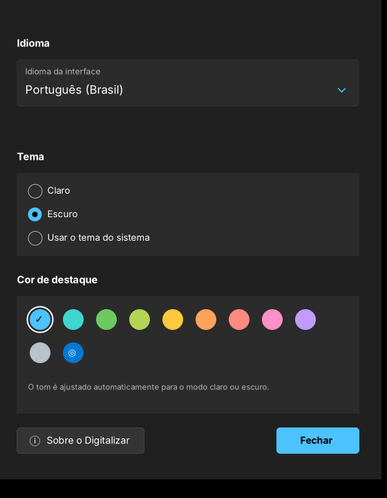
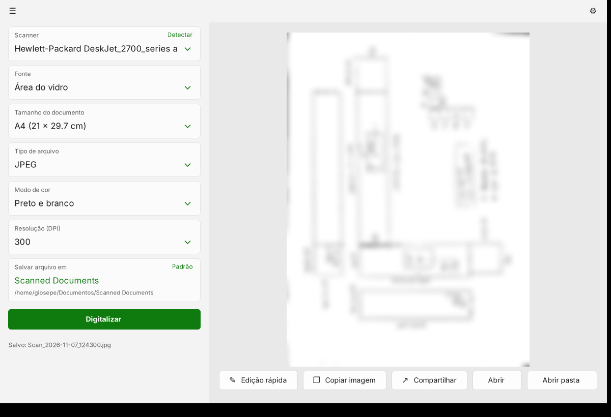
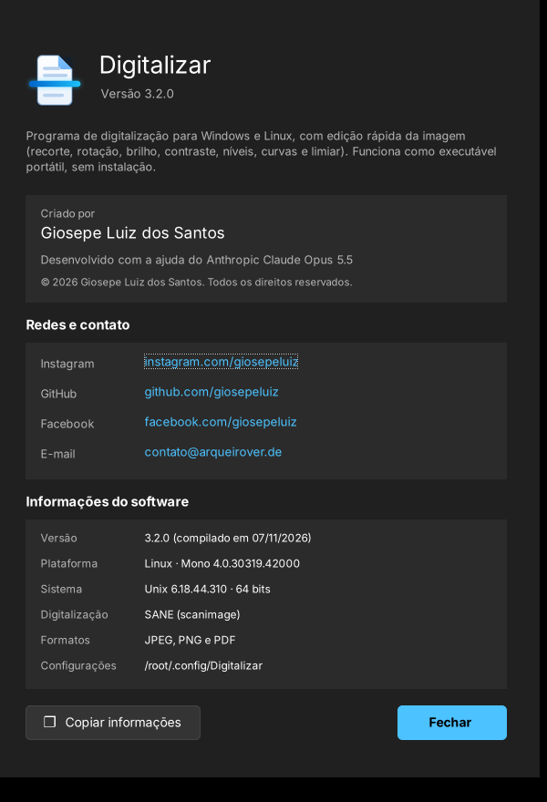

# 📘 Manual do Digitalizar

Guia completo de todas as funções da versão **3.2**. Para começar rápido, veja o [README](../README.md).

## Índice
1. [Instalação](#1-instalação)
2. [Tela principal](#2-tela-principal)
3. [Opções de digitalização](#3-opções-de-digitalização)
4. [Depois de digitalizar](#4-depois-de-digitalizar)
5. [Edição rápida](#5-edição-rápida)
6. [Opções e aparência](#6-opções-e-aparência)
7. [Sobre](#7-sobre)
8. [Atalhos de teclado](#8-atalhos-de-teclado)
9. [Problemas comuns](#9-problemas-comuns)

---

## 1. Instalação

### Windows 10 / 11
1. Baixe o `Digitalizar-3.2.0-windows.zip` em [Releases](https://github.com/giosepeluiz/project-scanner/releases/latest).
2. Descompacte onde quiser (pode ser num pendrive).
3. Abra o `Digitalizar.exe`.

Não é preciso instalar nada: o programa usa o .NET Framework, que já vem no Windows. Na primeira vez, se aparecer *"O Windows protegeu o computador"*, clique em **Mais informações → Executar assim mesmo**.

### Linux
```bash
sudo apt install mono-complete sane-utils   # requisitos (Debian/Ubuntu/Mint)
sudo apt install hplip                      # drivers HP, se for o caso
tar -xzf Digitalizar-3.2.0-linux.tar.gz && cd Digitalizar
./digitalizar.sh                            # abre o programa
./instalar-atalho.sh                        # cria o atalho no menu (opcional)
```
Para confirmar que o Linux enxerga o scanner, rode `scanimage -L` no terminal.

---

## 2. Tela principal



| Área | Função |
|---|---|
| **☰** (canto superior esquerdo) | Recolhe e expande o painel lateral |
| **⚙** (canto superior direito) | Abre as Opções |
| **Painel lateral** | Opções de digitalização e o botão **Digitalizar** |
| **Área central** | Pré-visualização da última imagem digitalizada |
| **Barra inferior** | Ações: Edição rápida, Copiar, Compartilhar, Abrir, Abrir pasta |

No Windows, a barra de título faz parte do app: arraste-a para mover a janela, dê duplo clique para maximizar ou passe o mouse no botão maximizar para ver os layouts de encaixe do Windows 11.

Com o painel recolhido, a imagem ganha mais espaço e continua disponível o botão de digitalizar:



---

## 3. Opções de digitalização

Cada opção é um card: clique para abrir a lista e escolher.

| Opção | Valores | Padrão |
|---|---|---|
| **Scanner** | Scanners encontrados no computador. **Detectar** procura de novo | A HP, se houver |
| **Fonte** | Área do vidro | Área do vidro |
| **Tamanho do documento** | A4, A5, A6, B5, B6, Carta, Executivo, Foto 10 × 15, Foto 13 × 18, Cartão de visita, Área máxima do vidro | A4 |
| **Tipo de arquivo** | JPEG, PNG, PDF | JPEG |
| **Modo de cor** | Cor, Cinza, Preto e branco | Preto e branco |
| **Resolução (DPI)** | 75, 150, 300, 600, 1200 | 300 |
| **Salvar arquivo em** | Clique para escolher a pasta; **Padrão** volta à original | *Scanned Documents* |



### Tamanhos (largura × altura)
| Tamanho | Medidas | Norma |
|---|---|---|
| A4 | 21 × 29.7 cm | ISO 216 |
| A5 | 14.8 × 21 cm | ISO 216 |
| A6 | 10.5 × 14.8 cm | ISO 216 |
| B5 | 17.6 × 25 cm | ISO 216 |
| B6 | 12.5 × 17.6 cm | ISO 216 |
| Carta | 21.59 × 27.94 cm | EUA |
| Executivo | 18.42 × 26.67 cm | EUA |
| Foto 10 × 15 | 10 × 15 cm | — |
| Foto 13 × 18 | 13 × 18 cm | — |
| Cartão de visita | 8.5 × 5.5 cm | — |
| Área máxima do vidro | o que o scanner permitir | — |

> 📐 Encoste sempre o documento no **canto de referência** do vidro: a área digitalizada começa nesse canto.

### Que resolução usar?
- **75–150 DPI:** pré-visualizações e imagens para a web.
- **300 DPI:** documentos, contratos e notas. É o melhor equilíbrio.
- **600 DPI:** desenhos com traços finos e fotos.
- **1200 DPI:** só quando precisar ampliar muito. Os arquivos ficam enormes e a digitalização demora vários minutos.

### Nome dos arquivos
Os arquivos são salvos automaticamente com o nome `Scan_AAAA-MM-DD_HHMMSS` mais a extensão (por exemplo `Scan_2026-11-07_124300.jpg`). Se já existir um arquivo com o mesmo nome, é acrescentado `_1`, `_2`…

---

## 4. Depois de digitalizar

| Botão | O que faz |
|---|---|
| **Edição rápida** | Abre o editor. Duplo clique na pré-visualização também abre |
| **Copiar imagem** | Copia a imagem para a área de transferência: cole com Ctrl+V em qualquer programa |
| **Compartilhar** | Windows: abre a janela de partilha do sistema. Linux: abre a pasta do arquivo |
| **Abrir** | Abre o arquivo no programa padrão |
| **Abrir pasta** | Abre a pasta com o arquivo selecionado |

Em janelas estreitas, os botões mostram só o ícone; passe o mouse para ver o nome.

---

## 5. Edição rápida



A pré-visualização atualiza na hora. Ao salvar, tudo é aplicado na **resolução original**.

### Girar
- **Ângulo:** −180° a +180°. Perto de 0°, ±45°, ±90°, ±135° ou 180°, o slider **encaixa** sozinho.
- **↺ 90° / ↻ 90°:** giram um quarto de volta para cada lado.

### Recortar
1. Clique em **Recortar**.
2. Arraste na imagem para marcar a área. Arraste por dentro para mover, ou pelos cantos para redimensionar.
3. Clique em **Concluir** ou tecle **Enter**.

**Remover recorte** volta à imagem inteira.

### Recorte rápido


1. Ligue o switch **Recorte rápido**.
2. Digite quantos pixels cortar (padrão **3**).
3. Clique em **Aplicar** (ou Enter).

A mesma medida é cortada em todas as bordas, a partir do recorte atual: aplicar duas vezes com 3 px corta 6 px no total. É ideal para tirar a borda preta que alguns scanners deixam.

### Luz
- **Brilho** (−100 a +100) e **Contraste** (−100 a +100).

### Níveis
- **Entrada – preto:** tudo o que for mais escuro que este valor vira preto.
- **Entrada – branco:** tudo o que for mais claro vira branco. Ótimo para limpar o fundo do papel.
- **Tons médios (gama):** clareia (> 1.00) ou escurece (< 1.00) os tons médios.
- **Saída – preto / branco:** limitam o preto mais escuro e o branco mais claro do resultado.

### Curvas


- **Clique** na curva para criar um ponto e **arraste** para ajustar.
- **Botão direito** num ponto remove-o.
- O **histograma** ao fundo mostra a distribuição dos tons da imagem.
- **Repor curva** volta à linha reta.

### Limiar
Ligue **Ativar limiar** para converter em preto e branco puro e ajuste o ponto de corte (1 a 254). Perfeito para desenhos à mão e documentos com fundo sujo.

### Salvar
- **Salvar** (Ctrl+S): substitui o arquivo digitalizado.
- **Salvar como…** (Ctrl+Shift+S): escolhe outro nome, pasta e formato.
- **Repor tudo:** desfaz todas as edições.
- **Cancelar / Esc:** fecha (pergunta antes, se houver alterações).

---

## 6. Opções e aparência



- **Idioma:** na primeira vez, o programa usa o idioma do sistema (ou inglês, se o idioma do sistema não estiver disponível). Escolha outro na lista. Os principais aparecem primeiro: Português (Brasil), Português (Portugal), English (US), English (UK) e Español. Depois de um traço vêm Deutsch, Français, Italiano, Nederlands, Polski, Русский, Türkçe, Українська, 日本語 e 中文. Para aplicar, clique em **Reiniciar agora**. A opção **Idioma do sistema** volta a seguir o idioma do Windows ou do Linux.
- **Tema:** Claro, Escuro ou *Usar o tema do Windows*. Este último muda sozinho quando o Windows muda.
- **Cor de destaque:** 10 cores ou a cor de destaque do Windows (círculo com o ícone de sistema). O tom é ajustado automaticamente para o modo claro ou escuro.



### O que fica guardado
Tudo o que você escolhe é lembrado na próxima vez: idioma, tema, cor de destaque, scanner, tamanho do documento, tipo de arquivo, modo de cor, resolução, pasta de destino, painel recolhido ou expandido, tamanho e posição da janela (e se estava maximizada) e o valor do Recorte rápido. Os valores de fábrica (A4, JPEG, Preto e branco, 300 DPI) só são usados na primeira vez.

As escolhas ficam guardadas em:
- Windows: `%APPDATA%\Digitalizar\config.ini`
- Linux: `~/.config/Digitalizar/config.ini`

---

## 7. Sobre



Abra com **F1** ou pelo botão **Sobre o Digitalizar** nas Opções. A janela mostra o autor, as redes sociais, o contato e as informações técnicas; **Copiar informações** copia tudo (útil para relatar problemas).

---

## 8. Atalhos de teclado

| Tecla | Onde | Ação |
|---|---|---|
| `F1` | Tela principal | Sobre |
| `Ctrl + S` | Edição rápida | Salvar |
| `Ctrl + Shift + S` | Edição rápida | Salvar como |
| `Enter` | Recorte | Concluir o recorte |
| `Enter` | Campo do recorte rápido | Aplicar |
| `Esc` | Recorte / janelas | Sair do recorte / fechar |
| Duplo clique | Slider | Voltar ao valor padrão |

---

## 9. Problemas comuns

| Problema | Solução |
|---|---|
| *"Nenhum scanner encontrado"* | Ligue a impressora, confirme que está no mesmo Wi-Fi (ou no USB) e clique em **Detectar**. No Windows, confira se ela aparece em *Configurações › Impressoras e scanners* |
| *"O scanner está ocupado"* | Feche outros programas de digitalização e tente de novo |
| *"Tampa aberta?"* | Feche a tampa do scanner |
| A imagem saiu maior/menor que o papel | Confira o **Tamanho do documento** e se o papel está no canto de referência |
| O Windows bloqueou o programa | **Mais informações → Executar assim mesmo**, ou botão direito no `.exe` → Propriedades → **Desbloquear** |
| Linux: `scanimage` não encontrado | `sudo apt install sane-utils` |
| Linux: scanner HP não aparece | `sudo apt install hplip` e depois `hp-setup` |
| Linux: o programa não abre | Instale o Mono: `sudo apt install mono-complete` |

Não resolveu? Abra uma [Issue](https://github.com/giosepeluiz/project-scanner/issues) com as informações copiadas do **Sobre**.
